# 主流车型 HUD / AR-HUD 功能与模式研究

研究日期：2026-11-23。26 款目的性样本，按所列市场、年款、配置和证据理解。不是市场销量榜；未确认不等于不支持。

网页演示：[车型功能研究](vehicle-function-study.html)。[完整矩阵](vehicle-function-matrix.csv)／[证据与图源](vehicle-function-evidence.json)。

## 核心认识

AR 说明与真实道路的空间关系；SR 说明环境如何重建；地图提供路线关系；TBT 提供下一动作。四者可共存，不是统一的四选一模式。

## 功能术语

### HUD · Head-Up Display／抬头显示

让车速、导航或告警进入前方视野，减少向下寻找仪表的次数。它描述显示出口，不代表任何特定导航模式。

注意：车速、限速、状态通常使用稳定位置。

### W-HUD / C-HUD · 风挡反射／独立组合玻璃 HUD

W-HUD 用风挡作反射面；C-HUD 用独立透明片。它们是光学架构分类。

注意：W-HUD 可以是普通 HUD，也可承载 AR 内容；不能与 AR 二选一。

### AR / AR-HUD · Augmented Reality／增强现实

将路线、车道或目标提示关联到真实道路位置；帮助回答“就在前面哪个路口、哪条车道”。

注意：先有 HUD 硬件与数据链路，再由地图、定位、感知及车辆姿态配合；“3D”外观本身不证明已贴路。

### SR · 本研究用作环境／场景重建的统称

把自车、前车、车道等重新绘制成一个可理解的环境模型，帮助理解车辆识别到什么、准备做什么。

注意：不强行统一英文全称：不同品牌可称 Scene Reconstruction、Surrounding Reality、模拟现实、ESD／环境感知。须看画面及手册。

### SR-HUD · 品牌命名的模拟现实 HUD

例如魏牌蓝山，用 HUD 呈现重建式道路与导航。

注意：它不是自动高于或低于 AR-HUD 的通用技术等级；能重建不等于能对齐真实道路。

### 地图 / 小地图 · 二维或透视路线图

显示连续的道路关系、路线、后续转向和上下匝道关系，便于提前理解路径。

注意：地图可以在固定 HUD 区内显示；透视地图也可能仍是地图，不能凭倾斜角度归 AR。

### TBT · Turn-by-Turn／逐向导航

用转向箭头、距离、道路名表达下一动作，阅读量较小。

注意：TBT 是导航信息粒度；既可固定显示，也可用 AR 形式表现。EV6 同时列普通 TBT 与 AR TBT。

### 车道级导航 · 告诉驾驶员应选哪条车道

可用车道条、地图、路口放大或道路光毯实现，减少临近路口才并线。

注意：车道级是导航精度／引导颗粒度，不自动等于 AR。

### 路口放大图 · Junction View／复杂节点局部图

导航接近目标路口时，把分叉、车道和方向放大，补足小地图细节。

注意：图形路口放大仍可能在固定窗口里；它与摄像头 AR 视频不是同一种功能。

### 导航光毯 / AR 箭头 · 把行驶方向关联到道路

用于路口、转弯或路径选择；光毯强调应走通道，箭头强调动作和方向。

注意：导航路线表达“应往哪走”；辅助驾驶轨迹表达“系统准备怎么走”，两种来源应区分。

### 辅助驾驶意图 / 轨迹 · 显示将要变道、超车、启停等意图

帮助驾驶员理解系统接下来的行为，并发现与预期不符之处。

注意：必须区分可用、激活、执行中、失败／请求接管；显示路径不等于车辆已经执行。

### ACC / SCC · 自适应巡航／Smart Cruise Control

主要辅助纵向跟车和速度控制；HUD 可显示设定车速、跟车距离与目标车。

注意：巡航设定车速与真实车速是两项，不应用同一语义位置。

### LCC / LFA / IACC / HDA · 车道居中／车道跟随／集成巡航／高速辅助等厂商系统名

HUD 用车道、方向盘状态、目标和接管提醒表达相应辅助状态。

注意：功能范围依品牌和版本，不能按缩写相似就认定完全同能。

### NOA / NCA / NGP / NAD · 领航辅助及品牌辅助驾驶名称

可能结合导航完成跟车、变道和匝道等任务；HUD 可显示其意图和状态。

注意：这里不统一为同等级自动驾驶；AR 导航本身也不要求这些系统已激活。

### FCW / LDW / BSD / BSM / FCTA · 碰撞／偏离／盲区／横向来车等提醒

在检测到对应风险时及时提醒；可用文字、图标、声音或目标关联高亮。

注意：BSM 图标是风险提示；盲区摄像头影像是视频信息，两者不能混记。

### TSR / 限速 / 红绿灯倒计时 · 交通标志识别与道路数据

帮助识别限速、道路指示及信号灯剩余时间。

注意：可能来自摄像头、地图或联网服务；倒计时显示不证明车辆会自动过灯。

### 盲区 / 后视 / 泊车影像 · 摄像头原始视频

补充侧后方或低速环境视野；部分国内样本允许进入 HUD。

注意：真实摄像头视频不是 SR；叠有导航的实景视频也不自动是透明风挡 AR-HUD。

### 经典 / 极简 / 全部 / 沉浸 · 信息量和布局的用户偏好

在基础读数、地图、环境和舒适内容之间调配空间。

注意：模式名不通用；需记录它在导航、辅助驾驶、倒车等状态下是否会被覆盖。

### 雪地 / 增强 / 日夜 · 配色或可读性设置

在积雪、明暗等背景中改善区分；例如理想橙色、乐道黄色。

注意：改色不是新的导航能力；不是所有车型会根据下雪自动启用。

### PHUD / Panoramic Vision · 风挡下缘全景信息带

在风挡黑区形成宽幅信息带，可承载卡片、导航或座舱信息。

注意：小米 YU7 与宝马信息带为架构对照；宝马另有独立 3D HUD，不能把两者合并。

### FOV / VID / Eyebox · 视场角／虚像距离／眼盒

决定看得到多宽、视觉成像在多远、头部可移动多大范围；影响显示内容能否稳定读到。

注意：“等效英寸”依赖虚像距离，不能用 87 英寸比 56 英寸就判功能或体验胜负。

### 媒体 / 歌词 / 观影 · 座舱舒适或驻车内容

音乐、来电、语音反馈可减轻寻找其他屏幕的动作；驻车观影属于另一任务。

注意：各功能按具体车速和挡位限制核验；问界 M8 观影明确只在 P 挡。

## 驾驶场景与触发

### 手动通勤

前置条件：没有激活辅助驾驶，可能也没有设置导航目的地。

显示分工：基线车速／状态；可由用户选择信息量。

车型例子：理想 i8 的环境模式、乐道 L60 的环境常驻，说明 SR 不一定要辅助驾驶激活。

### 导航中的路口 / 匝道

前置条件：存在有效路线，接近需要决策的节点。

显示分工：TBT 提供下一动作；小地图提供拓扑；AR 提供道路落点。三者可叠加。

车型例子：问界 M9/M8 的实验室 AR 车道指引明确用于手动驾驶；EV6/IONIQ 5 在 AR 模式仍显示普通 TBT。

### ACC / 领航辅助

前置条件：系统已激活，相应对象或任务满足显示条件。

显示分工：用状态、目标车、车距、意图或轨迹表达当前辅助行为。

车型例子：深蓝 S07 的目标标记要求 ACC/IACC＋检测到对象；理想 i8 会自动增加地图／环境；大众 ACC/Travel Assist 各自有显示。

### 打转向灯

前置条件：用户开启影像功能，并满足该车型显示条件。

显示分工：侧后摄像头画面或盲区风险符号；不与 SR 混称。

车型例子：理想 i8、问界 M9/M8 有明确转向触发；问界极简模式禁用转向灯影像。

### 倒车 / 低速泊车

前置条件：进入对应挡位、泊车任务或影像条件。

显示分工：只有厂商明确支持时才计入 HUD 后视／泊车影像。

车型例子：问界 M9/M8、全新 C11 明确有 HUD 后视影像；VISTIQ 手册明确 HUD 图像不能当作泊车辅助。

### 雪地 / 低能见度

前置条件：使用者开启增强配色，或触发已说明的环境功能。

显示分工：提高文字与背景的区分；AR 可用性仍需看感知和注册质量。

车型例子：深蓝 Standard/Snow 是配色；乐道雪地变黄；小鹏发布演示有雨雾目标提示；不能写成全行业雨天自动切 SR。

### P 挡驻车

前置条件：车辆处于 P 挡，执行设置或驻车娱乐。

显示分工：允许相应视线／高度校准或明确获准的娱乐显示。

车型例子：问界 M8 观影只在 P 挡；蓝山高度自适应／多模态调节要求 P 挡；歌词不自动等于视频观影。

场景归纳来源：[M9](#来源-m9)、[M8](#来源-m8)、[LI](#来源-li)、[L60](#来源-l60)、[S07](#来源-s07)、[EV6](#来源-ev6)、[VW-V](#来源-vw-v)、[GM](#来源-gm)、[WEY](#来源-wey)。

## 各车型功能、模式与原图

### 问界 M9

中国品牌｜2026 增程版／中国手册｜AR-HUD

图像：官方手册图；2026 款增程版 · 中国手册。[原始出处](https://hima.auto/dam/hima-site/cn/wenjie/service/pdf/260930/问界M92026款增程版使用说明书.pdf)。

读图：左侧小地图＋固定车速＋上方箭头；原图中的箭头只能说明图示内容。

- **模式与设置：** 经典／极简；AR 增强、小地图等独立开关
- **AR 导航：** 确认：开启实验室 AR 车道指引，手动驾驶＋导航路线＋对应路况时显示光毯或箭头。不能把这条规则改写为必须开启 NCA。
- **SR／环境：** 手册确认辅助驾驶时可显示意图文字；未将独立 SR 全景重建列为本次确认项。
- **地图：** 确认：小地图独立开关，默认开启。与 AR 车道指引不是同一设置。
- **TBT：** 原图有方向和距离；不代表必须关闭小地图才出现。
- **辅助驾驶与告警：** 辅助驾驶模式＋意图文字开关：显示辅助驾驶意图；安全预警另由 HIMA 实验室开关控制。
- **影像／环境／驻车：** 经典模式可用转向灯盲区影像、倒车后视影像；极简模式禁用这两项。雪地增强、红绿灯倒计时独立设置。
- **边界与待核：** 本手册只支持系统自带地图导航。AR 增强默认开启，不等于实验室 AR 车道指引默认开启。

事实依据：[M9](#来源-m9)。

### 问界 M8

中国品牌｜增程版／2026-09 中国手册｜AR-HUD

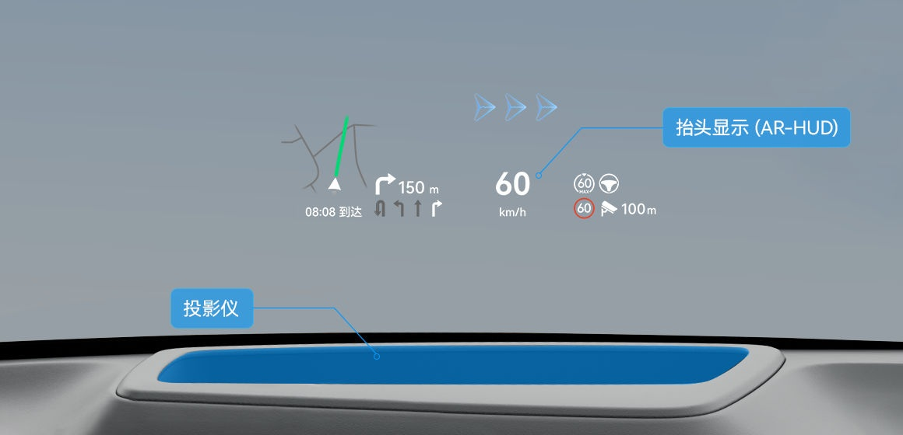

图像：官方手册图；中国增程版 · 2026-09 手册。[原始出处](https://hima.auto/dam/hima-site/cn/wenjie/service/pdf/260930/问界M8增程版使用说明书.pdf#page=28)。

读图：小地图和 150 m 转向提示在车速左边，蓝色箭头在上方

- **模式与设置：** 经典／极简；AR 增强、车道指引等独立设置
- **AR 导航：** 确认：实验室 AR 车道指引开启后，手动驾驶时按导航路线及对应路况呈现光毯或箭头。
- **SR／环境：** 确认辅助驾驶意图文字；独立 SR 场景全景的开关及触发条件未在 HUD 章核实。
- **地图：** 确认小地图开关；方向、地图与 AR 功能分开配置。
- **TBT：** 原图确认转向箭头及距离；简化模式的逐元素保留表待核。
- **辅助驾驶与告警：** 辅助驾驶意图文字在辅助驾驶模式触发；不将中控 ADS 3D 视图自动计入 HUD。
- **影像／环境／驻车：** 经典模式的转向盲区／倒车影像；雪地增强。AR-HUD 视频流转仅 P 挡可用。
- **边界与待核：** 仅系统自带地图。极简模式不能使用转向影像与倒车影像；观影不能放入行车功能清单。

事实依据：[M8](#来源-m8)。

### 小鹏 G7

中国品牌｜2025-06 追光全景发布演示／中国｜AR-HUD

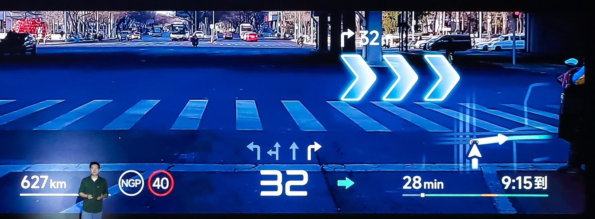

图像：官方发布会摄影 · 局部；2025 首发演示 · 中国。[原始出处](https://www.xiaopeng.com/news/company_news/5473.html)。

读图：发布会屏幕局部：上方道路箭头与光毯，下方固定车速、车道和路线卡片。

- **模式与设置：** 三类场景：导航、辅助驾驶、安全；不是三个互斥设置档位
- **AR 导航：** 官方演示：变道、转弯、复杂路口采用 AR 光毯；不可行岔路可显示 X。具体量产版本及开关待对应车主手册核验。
- **SR／环境：** 以贴合道路的路径和对象提示表达意图；不能据此确认还有独立 SR 小窗模式。
- **地图：** 发布演示有右侧路线信息；独立全地图模式及自动切换规则未公开。
- **TBT：** 演示底部方向和车道符号可与道路 AR 共存；完整 TBT 设置待核。
- **辅助驾驶与告警：** 官方展示变道、红绿灯启停、超车和泊车路径意图；其可用性依赖对应辅助驾驶功能。
- **影像／环境／驻车：** 官方列出雨雾前车／车道、窄路会车、弯道及盲区等预警场景；不采纳“最全”等宣传排名。
- **边界与待核：** 这些是发布演示范围，没有为每项取得交付版本／速度阈值；不能据演示证明已在所有车主车辆上线。

事实依据：[G7](#来源-g7)。

### 零跑 全新 C11

中国品牌｜2026 款／2025 联合技术发布｜AR-HUD

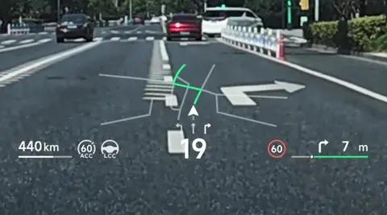

图像：媒体转载 HUD 场景图；2026-06-01 文章；原始拍摄者／软件版未知。[原始出处](https://k.sina.cn/article_7857141524_1d452771401902xlfs.html)。

读图：固定读数 19、右转 7 m 与小地图同屏；只确认画面可见内容，不能反推激活或切换条件。

- **模式与设置：** 车速／AR／地图三模式，可切换
- **AR 导航：** 确认 AR 模式及路线显示能力；何种路口、距离、车速自动触发未在一手资料说明。
- **SR／环境：** 联合发布未给独立 SR 模式；ADAS 数据融合不等于已经确认 SR 画面。
- **地图：** 确认地图模式；不能凭名称宣称“只在高速”或“城市自动切地图”。
- **TBT：** 转载图中可见固定转向距离与小地图共存；独立开关与自动切换规则仍待手册。
- **辅助驾驶与告警：** 企业披露确认 ADAS、座舱、HUD 数据融合；尚未给出逐辅助功能的显示条件。
- **影像／环境／驻车：** 联合发布明确 HUD 可显示盲区影像及倒车影像；具体触发开关、速度门槛待手册。
- **边界与待核：** 图片由媒体转载，拍摄者和软版未知；功能模式依据联合发布。不采用供应商文章的通用配图；2023 中控 AR 视频不等于 AR-HUD。

事实依据：[C11](#来源-c11)、[C11-F](#来源-c11-f)、[C11-I](#来源-c11-i)。

### 魏牌 全新蓝山

中国品牌｜2025-10 手册／2024 发布前静态画面｜SR-HUD

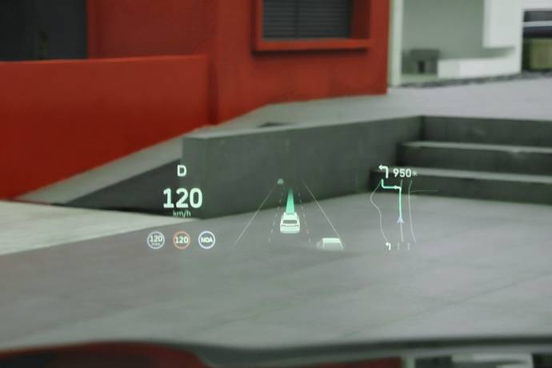

图像：媒体实车静态演示；2024-04 发布前静态演示；不是道路实测。[原始出处](https://m.youcheyihou.com/news/1448654)。

读图：中央为车道／前车重建，右侧小地图和 250 m 指令。背景静止，HUD 显示 P 挡与演示车速。

- **模式与设置：** SR-HUD 显示模式＋地图设置＋增强模式
- **AR 导航：** 未确认道路注册 AR 导航；不能把 SR-HUD 的商品名直接改成 AR-HUD。
- **SR／环境：** 品牌将 SR-HUD 称为模拟现实抬头显示。实拍有车辆、车道重建；手册允许切模式，但未列出各模式名与 NOA 自动切换条件。
- **地图：** 确认地图设置；开启路口放大图后，导航到路口时自动显示路口放大图。
- **TBT：** 静态图有方向与距离；手册未明确 TBT／地图的独立模式名称。
- **辅助驾驶与告警：** 图中车辆／车道是重建画面；NOA 时是否强制出现、退出后是否保留，待版本实测。
- **影像／环境／驻车：** 增强模式将部分内容改高亮色；歌词开关＋支持歌词的歌曲触发。高度自适应及注视语音调节要求 P 挡和相关感知功能。
- **边界与待核：** 静态演示的车速值不是实车车速。2025 手册的歌词功能不能用 2024 照片证明；影院模式未作本版确认项。

事实依据：[WEY](#来源-wey)、[WEY-C](#来源-wey-c)、[WEY-I](#来源-wey-i)。

### 理想 i8

中国品牌｜2026 Max／2026-08 官方手册｜固定信息区 HUD

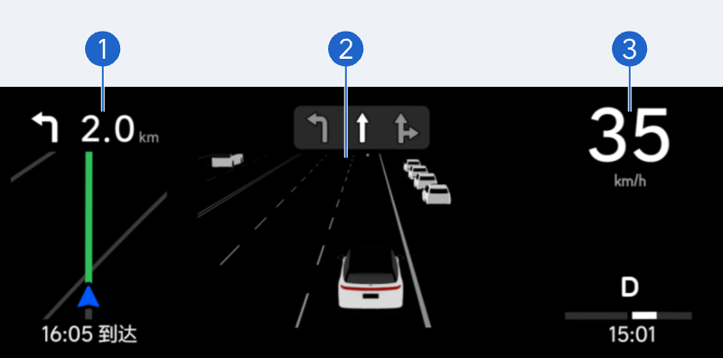

图像：官方手册图；2026 Max · 中国手册。[原始出处](https://manuals.lixiang.com/zh-cn/W022026MAX/20260805185610/topic-2025-B9EDF622.html)。

读图：左导航、中环境与辅助驾驶、右车速。是固定分区中的 SR，不能据车道透视认定为道路 AR。

- **模式与设置：** 车速／地图／环境／全部；地图再分简洁／详细
- **AR 导航：** 本次未确认贴合真实道路的 AR 导航；HUD 内环境车辆图不能当作 AR 注册证据。
- **SR／环境：** 确认“环境”模式。辅助驾驶开启后，“车速”模式仍加入地图和环境，“地图”模式加入环境，“环境”模式加入地图。
- **地图：** 确认地图模式及详细小地图；开启路口放大后，导航至要汇入路口自动放大。
- **TBT：** “地图信息→简洁”显示精简导航；这是信息简化方式，不必称为地图关掉。
- **辅助驾驶与告警：** 中央区显示辅助驾驶信息、提示与告警；辅助驾驶优先增加内容，覆盖用户较简模式的部分偏好。
- **影像／环境／驻车：** 数字后视镜影像开关开启后，打转向灯出现侧后方画面。雪地模式呈橙色；车速模式不显示红绿灯倒计时。
- **边界与待核：** 三分区 HUD 不等于三光学焦面。手册未说明倒车影像，不能由侧后方影像外推。

事实依据：[LI](#来源-li)。

### 乐道 L60

中国品牌｜2025-10-28 中国用户手册｜固定信息区 HUD

图像缺口：已取得手册正文；内容原图待补。[原始来源入口](https://cdn-up-public.onvo.cn/www-alps-cn/user-instructions/L60-User-Manual-20251028.pdf#page=101)。

- **模式与设置：** 环境感知常驻开关；雪地模式；亮度／高度／倾角
- **AR 导航：** 本次手册未确认道路贴合式 AR 导航；不因显示区较大就归类 AR。
- **SR／环境：** 确认：开启“环境感知常驻显示”后，HUD 始终展示周围环境感知。无需把 SR 描述成只在 NOA 时才出现。
- **地图：** 本手册 HUD 设置段未给出小地图独立模式，保留未核验。
- **TBT：** 导航在 HUD 的逐指令形式和显示条件，需结合相应版本补图；本版不由整车导航反推。
- **辅助驾驶与告警：** 常驻感知是显示偏好；不等于辅助驾驶处于激活状态。
- **影像／环境／驻车：** 雪地模式改黄色；座椅大幅移动时可自适应高度；设置可记忆。
- **边界与待核：** 本次拿到的 HUD 设置页以文字为主，未附 HUD 内容画面；另提供原始手册定位。

事实依据：[L60](#来源-l60)。

### 小米 SU7

中国品牌｜2024 初代 HUD 实拍；2026 配置及 OTA 线索分开｜固定信息区 HUD

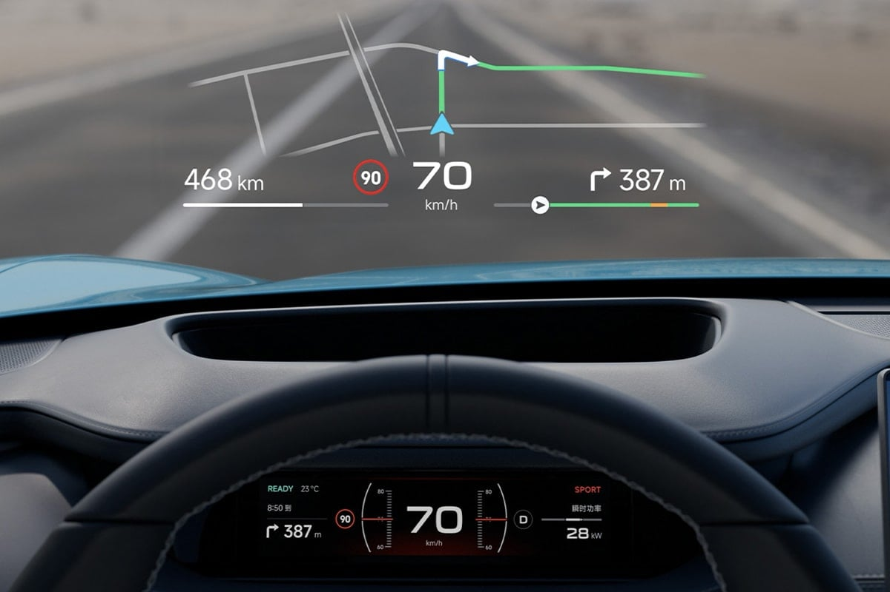

图像：厂商图 · 媒体转载；初代发布图 · 2024。[原始出处](https://www.electrive.com/2024/05/07/first-drive-xiaomi-su7-tracing-the-rise-of-xiaomi/)。

读图：2024 媒体实拍：地图、车速、限速和 387 m 转向信息同屏。地图是固定画面内容。

- **模式与设置：** 当前确认图示有小地图、转向距离、车速；新 OTA 模式待官方版本补证
- **AR 导航：** 本次未取得该样本贴合道路的 AR 导航一手证据。画面中悬浮路线图属于小地图。
- **SR／环境：** 整车官方配置列 SR，不足以确认当前 HUD 内的 SR 触发规则。2026 OTA 的媒体线索另列，未计入确认。
- **地图：** 2024 图中可见小地图；自动放大及可编辑卡片条件不由旧图推断。
- **TBT：** 实拍可见 387 m 转向提示，与小地图共存。
- **辅助驾驶与告警：** 当前官方配置有辅助驾驶；HUD 环境卡片／HAD 轨迹需对应一手 OTA 日志核验。
- **影像／环境／驻车：** 媒体报道的新布局与影像不与 2024 原图混成同一版本；在来源区提供继续追踪入口。
- **边界与待核：** 不把初代照片称为 2026 界面，不把“尚缺官方 HUD 说明”写成该功能不存在。

事实依据：[SU7-P](#来源-su7-p)、[SU7-I](#来源-su7-i)、[SU7-LEAD](#来源-su7-lead)。

### 极氪 007

中国品牌｜全球产品页首发代展示配置｜AR-HUD（厂商命名）

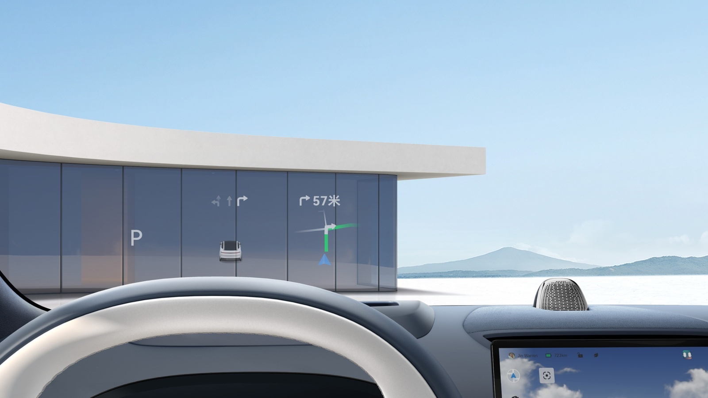

图像：官方车型图；全球车型页 · 展示配置。[原始出处](https://www.zeekrlife.com/global/vehicles/007)。

读图：官方图可见左侧车辆／车道、右侧路线与 57 m 提示；没有足够道路背景来验证空间注册。

- **模式与设置：** 独立模式菜单及自动切换规则未在产品页公开
- **AR 导航：** 官方称 AR-HUD；所选图主要展示地图、车速及重建，未据此确认道路贴合精度与 AR 触发条件。
- **SR／环境：** 图中可见车辆／车道重建；是否随辅助驾驶自动开启、是否可常驻待手册核验。
- **地图：** 官方图显示地图／路线；确认图示存在，不认定独立全地图模式。
- **TBT：** 图中有转向与 57 m 距离。
- **辅助驾驶与告警：** 图示不证明辅助驾驶已激活，也不证明存在独立“SR模式”名称。
- **影像／环境／驻车：** 亮度、雪地、影像及娱乐等设置未在所引产品段取得。
- **边界与待核：** AR-HUD 硬件名、图中看见的功能与具体软件逻辑是三种不同证据。

事实依据：[ZEEKR](#来源-zeekr)。

### 蔚来 ET7

中国品牌｜16.3 英寸产品页＋欧版在线 HUD 说明｜固定信息区增强 HUD

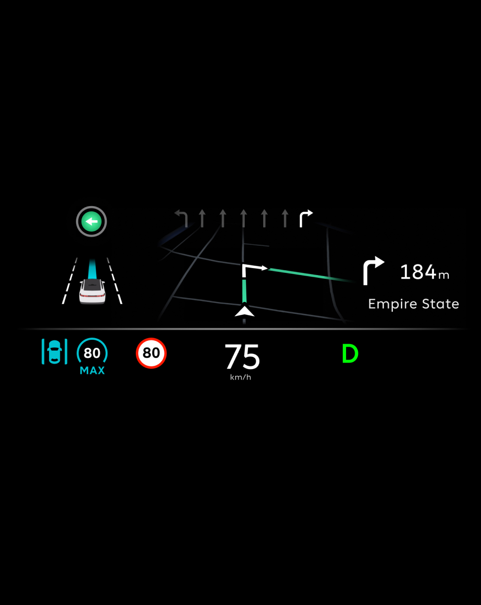

图像：官方产品界面图；16.3 英寸增强 HUD 产品展示；非驾驶员实拍。[原始出处](https://www.nio.com/et7)。

读图：黑底原图中右侧路线、左侧车辆与车道图标，下方为车速、挡位和巡航／限速信息。

- **模式与设置：** 可调亮度／高度等；产品页确认路口放大图
- **AR 导航：** “增强 HUD”并不自动等于道路注册 AR；本次一手资料未确认贴路 AR 导航。
- **SR／环境：** 产品图可见自车／车道与目标图标；完整 ESD 在手册另章，不能默认整个 ESD 都搬入 HUD。
- **地图：** 官方产品说明确认导航与路口放大图；何时从小地图切放大、是否可手动选择，资料未展开。
- **TBT：** 产品图有下一转向、184 m、道路名与路线图，同屏呈现。
- **辅助驾驶与告警：** 官方 HUD 说明列巡航、交通标志、Autohold 等；具体 NAD 意图类型及触发顺序待版本手册。
- **影像／环境／驻车：** 智能背景亮度控制；不根据产品页“增强”一词推导多焦面。
- **边界与待核：** 产品图目录为 2026-04；欧版在线手册可能覆盖不同软件。未将两者的所有选项组合成统一配置。

事实依据：[NIO](#来源-nio)、[NIO-P](#来源-nio-p)。

### 深蓝 S07

中国品牌｜澳大利亚 2025-11 手册／PDF 134–135｜AR-HUD

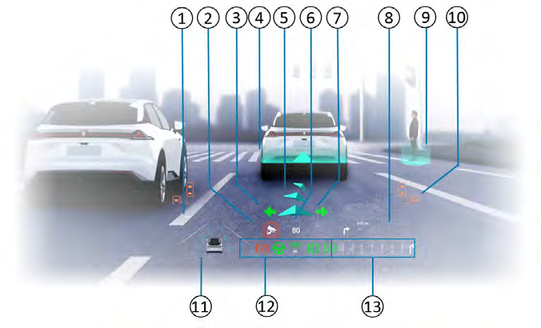

图像：官方手册图；2025 澳大利亚手册 · S07 系列。[原始出处](https://www.deepal.com.au/media/lemnpbqs/deepal_s07_owners_manual_211125.pdf#page=134)。

读图：路口引导与车道图形对齐到道路场景，上下分层

- **模式与设置：** Standard／Snow 是普通／雪地显示；非 AR／非 AR 切换
- **AR 导航：** 确认路口引导；导航激活且接近路口时，下方出现可行车道信息。手册未给光毯连续贴路与独立 AR 开关条件。
- **SR／环境：** 图例明确 Scene reconstruction＝车道线绘制与车辆渲染；该项单独的启停逻辑未说明。
- **地图：** 所引 HUD 章未列二维小地图模式。
- **TBT：** 路口引导信息与可行车道获确认；未在此章命名 TBT 模式。
- **辅助驾驶与告警：** ACC/IACC 已激活且检测到前车／行人时，在其位置显示标记；IACC 长时间未触方向盘出现文字提示；盲区障碍出现提醒。
- **影像／环境／驻车：** 续航开关开启后按设定时长滚动显示。Standard/Snow、亮度和高度可调。
- **边界与待核：** 前车／行人显示有明确 ACC/IACC 条件，不能写成任何驾驶状态都出现。澳洲手册不外推国内。

事实依据：[S07](#来源-s07)。

### 小米 YU7

中国品牌｜2025 天际屏产品图／架构边界样本｜PHUD 风挡下缘信息带

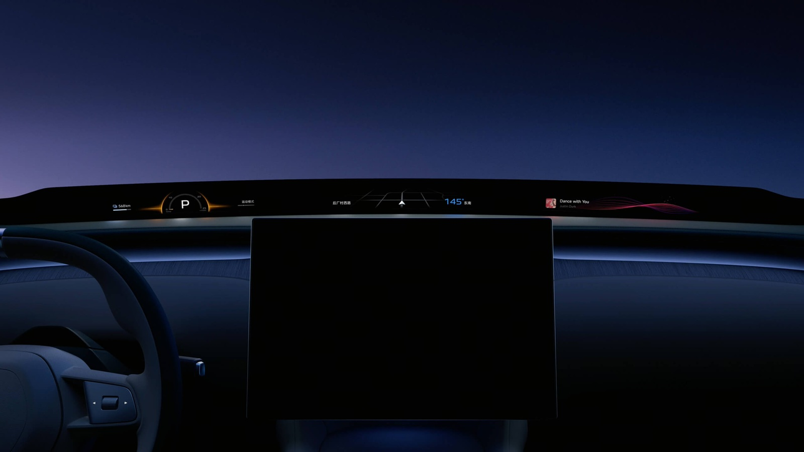

图像：官方车型图；2025 产品页 · 小米天际屏。[原始出处](https://www.xiaomiev.com/yu7)。

读图：全宽风挡黑区中的信息卡片；内容没有覆盖到透明道路区域。

- **模式与设置：** 卡片式全景显示；位于风挡下缘黑区
- **AR 导航：** 所选天际屏本身不是在透明道路视野中注册箭头的 AR-HUD；不纳入道路 AR 已确认样本。
- **SR／环境：** 可容纳环境类卡片；不能把黑区里的车辆重建叫作贴路 AR。具体常驻规则待手册。
- **地图：** 官方图含导航卡片；大地图与其他信息的分工需按天际屏而非传统 HUD 画板研究。
- **TBT：** 方向与路线可作为信息卡内容；本版不确认其独立模式菜单。
- **辅助驾驶与告警：** 辅助驾驶数据是信息来源之一，信息带显示与驾驶系统是否激活需分别判断。
- **影像／环境／驻车：** 可编辑卡片体现座舱信息带路线；不据此确认独立 AR-HUD 模组。
- **边界与待核：** 这是边界对照样本，国内外计数不代表所有样本拥有同类 HUD。

事实依据：[YU7](#来源-yu7)。

### 奔驰 S 级 W223

海外品牌｜2020 W223 可选 AR-HUD／2026 改款补充｜AR-HUD

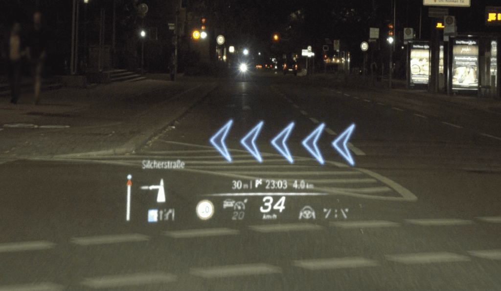

图像：经销商转载配图；2020 代际发布 · 可选 AR-HUD。[原始出处](https://media.mbusa.com/news/meet-the-s-class-digital-my-mbux-mercedes-benz-user-experience)。

读图：官方图展示道路关联引导与固定状态信息；技术图不是完整实车体验验证。

- **模式与设置：** 基本驾驶信息＋道路关联导航／驾驶辅助内容
- **AR 导航：** 官方确认导航箭头和车道建议可投到前方道路；导航启用、对应导航任务可用时呈现；精确触发距离未公开。
- **SR／环境：** 2026 MBUX Surround Navigation 的 3D 环境在驾驶员显示屏；官方另述 AR-HUD，不能把两块显示器合并。
- **地图：** 未确认 HUD 完整地图模式；详细地图和 Surround Navigation 应按仪表／中控分工阅读。
- **TBT：** 固定导航提示与 AR 提示可服务不同层级；没有取得与全部外部地图应用兼容的证明。
- **辅助驾驶与告警：** AR 可表达车距与驾驶辅助；不把显示能力等同于 DRIVE PILOT 的可用区域／自动驾驶等级。
- **影像／环境／驻车：** 图像取自 2020 技术发布；2026 改款新增信息另作文字说明，未伪装成新款实拍。
- **边界与待核：** 同属 MBUX 的中控摄像头 AR 导航，与 AR-HUD 是两个显示出口。

事实依据：[MB](#来源-mb)、[MB-26](#来源-mb-26)。

### 奥迪 Q6 e-tron

海外品牌｜2024 第二代 AR-HUD／德国技术资料｜AR-HUD

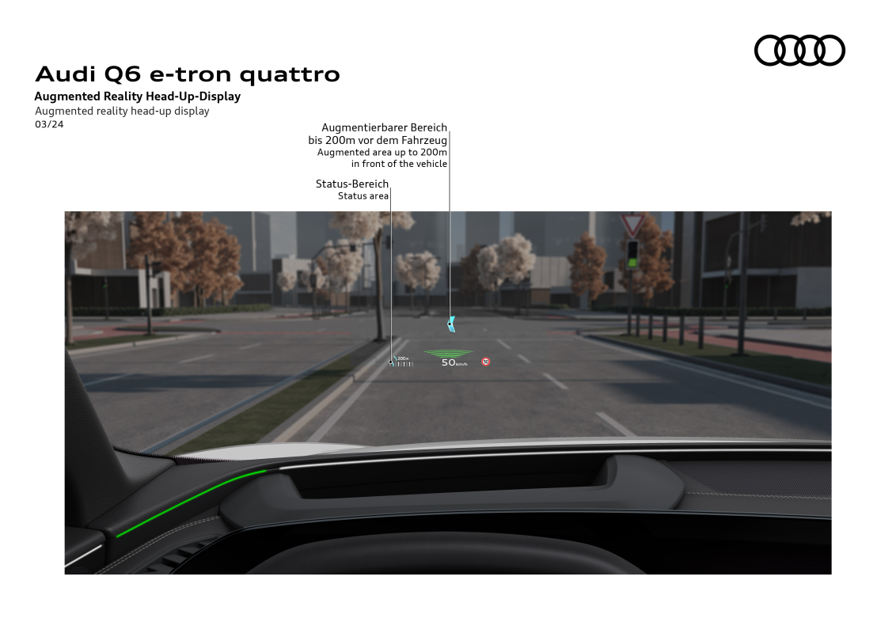

图像：官方技术示意；2024 Audi 技术图 · 第二代 AR-HUD。[原始出处](https://www.audi-technology-portal.de/en/electrics-electronics/controls/audi-q6-e-tron-new-display-operating-concept-en)。

读图：原图标注道路关联的增强区域

- **模式与设置：** 固定状态区＋斜像面道路关联内容
- **AR 导航：** 确认导航符号与环境关联；厂商描述可产生远至 200 m 的视觉印象，不是每条箭头的固定触发距离。
- **SR／环境：** 未确认独立 SR 环境模式；辅助提示不等于完整周围车辆重建。
- **地图：** 未在所引资料确认 HUD 二维地图模式。
- **TBT：** 有导航符号；固定 TBT 菜单、路口前触发距离及第三方应用条件待本车手册。
- **辅助驾驶与告警：** 官方明确显示辅助系统和交通标志；不从一张技术图推导所有告警种类。
- **影像／环境／驻车：** 还可显示音乐曲名及 Audi Assistant 头像；因此不能概括为“海外 HUD 只显示车速”。
- **边界与待核：** 官方提及 200 m 是显示感受，不应当作光学多焦面清单或启动阈值。

事实依据：[AUDI](#来源-audi)、[AUDI-I](#来源-audi-i)。

### 大众 ID.7 / Tourer

海外品牌｜欧洲；2024 Tourer 更新＋2025 官方操作视频｜AR-HUD

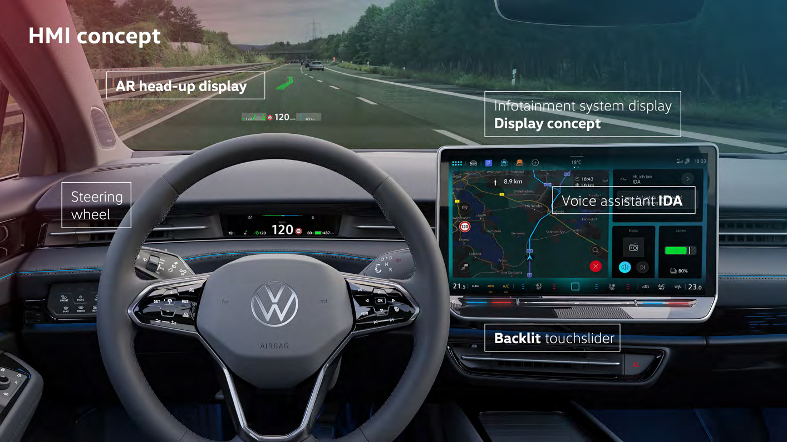

图像：官方技术资料 · 内嵌图；欧洲发布资料 · ID.7。[原始出处](https://www.volkswagen-newsroom.com/en/publications/more/the-new-id-7-2562/download#page=17)。

读图：官方发布 PDF 原图；近区固定状态与道路上方引导分开。

- **模式与设置：** 近区扩展／精简；可控制 AR 内容
- **AR 导航：** 确认与道路走向匹配的路线引导；2024 Tourer 更新将 CarPlay／Android Auto 活动导航接入 AR 路线显示。
- **SR／环境：** ACC 激活显示前车距离、Travel Assist 在车道内显示；未确认独立完整 SR 环境模式。
- **地图：** 近区有导航信息；未确认普通二维小地图的全屏模式。
- **TBT：** 固定近区导航与道路 AR 分层；View 可切近区信息量；不能外推任意手机地图应用均支持。
- **辅助驾驶与告警：** ACC 与 Travel Assist 的显示有明确激活条件，区别于单纯手动导航。
- **影像／环境／驻车：** 方向盘可切换电量、能耗；View 可切近区扩展／精简。
- **边界与待核：** Tourer 的手机接入更新不能无条件套用所有早期 ID.7、ID.4、中国 VIZZION。

事实依据：[VW](#来源-vw)、[VW-V](#来源-vw-v)。

### 宝马 新世代 iX3

海外品牌｜2025 发布／新世代；选装 3D HUD｜PHUD＋独立 3D HUD

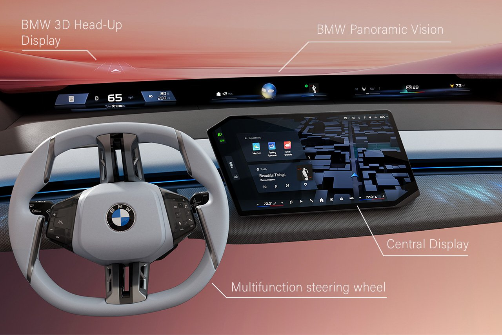

图像：官方系统示意 · 媒体转载；新世代 iX3 · 2025 技术发布。[原始出处](https://www.bmwgroup.com/en/news/general/2025/newidrive.html)。

读图：图中贯穿信息带和前方独立 HUD 是两层；不合并成一个超宽 AR 画布。

- **模式与设置：** Panoramic Vision 基础信息带＋选装 3D HUD 的导航／辅助
- **AR 导航：** 官方确认 3D HUD 的导航和驾驶辅助空间深度显示；本版按厂商“3D”命名记录，未据图宣称与全部道路目标精确贴合。
- **SR／环境：** 确认辅助驾驶图形会进入 3D HUD；未取得独立全场景 SR 模式菜单。
- **地图：** 导航与详细路线按 OS X 多显示区分工；不能把 Panoramic Vision 信息带直接当作 3D HUD 小地图模式。
- **TBT：** 基本导航与 3D 导航分层；第三方手机导航的 3D 效果兼容性未核验。
- **辅助驾驶与告警：** 3D HUD 整合导航和驾驶辅助显示；选装硬件是前提。
- **影像／环境／驻车：** 信息带可以个性化；四个交互单元分工明确。
- **边界与待核：** 旧款 iX3 与新世代配置不同；研究图是 2025 技术概念图，硬件量产证据另见车型发布。

事实依据：[BMW](#来源-bmw)、[BMW-I](#来源-bmw-i)。

### 凯迪拉克 VISTIQ

海外品牌｜2026 欧版手册；北美 Platinum 实拍｜双层 AR-HUD

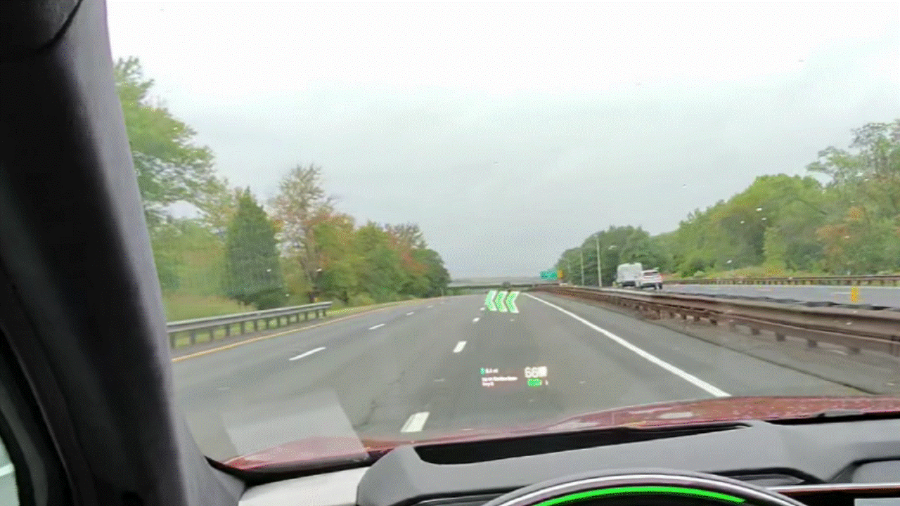

图像：媒体实车画面 · 视频帧；2026 Platinum · 北美媒体试驾。[原始出处](https://www.tomsguide.com/vehicle-tech/evs/i-drove-the-2026-cadillac-vistiq-for-a-week-and-its-just-the-right-mix-of-luxury-and-value)。

读图：北美道路实拍：固定基础读数与上方远区引导；不能从曝光比较各车真实亮度。

- **模式与设置：** Standard／Augmented Reality／Assist 三视图；均保留近层信息
- **AR 导航：** AR 视图的远层显示道路关联图形：导航有活动路线时显示，碰撞、车道保持和辅助变道按对应条件显示。
- **SR／环境：** Assist 视图显示激活中的辅助系统状态图形；不据此宣称完整 SR 环境全景。
- **地图：** 未确认 HUD 全屏二维地图；不能由车内 Google 地图推导。
- **TBT：** Standard 远层在车载导航路线激活时显示 TBT；无路线时远层不显示。Assist 视图也可同时显示 TBT。
- **辅助驾驶与告警：** AR 视图可显示配置 Super Cruise 时的按需变道；Assist 视图表达辅助系统状态；关键告警可能在 HUD 关闭时仍显示。
- **影像／环境／驻车：** 近层可显示来电、车速、限速；只有近层可调高度／旋转，远层固定。
- **边界与待核：** 欧洲手册＋北美实拍仅交叉说明架构；不合并为统一配置。手册明确不能把 HUD 图像当作泊车辅助。

事实依据：[GM](#来源-gm)、[GM-I](#来源-gm-i)。

### 现代 IONIQ 5

海外品牌｜英国 2022 手册／有 AR-HUD 配置｜AR-HUD

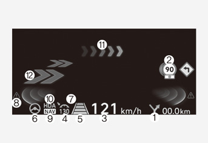

图像：官方手册图；2022 英国手册 PDF 59／5-59。[原始出处](https://manuals.hyundai.co.uk/umanuals/ioniq-5/ioniq-5-2022-convenience-features.pdf#page=59)。

读图：AR 图例同时包含固定读数和道路关联箭头。与本页 Standard 图并看，观察车辆重建的差别。

- **模式与设置：** Augmented reality／Standard／Off；AR 匹配校准
- **AR 导航：** 确认 AR 模式额外给出 AR 转向、车道安全、前车及起步提示；部分图项依赖 Highway Lane Change Assist 配置。
- **SR／环境：** Standard 模式图例有 Surrounding vehicle information，是本研究所称 SR 类显示；不是只有 AR 模式才有车道／前车。
- **地图：** 所引 HUD 章没有完整小地图模式；不能由车机地图功能外推。
- **TBT：** 普通 TBT 在 AR 和 Standard 均有；AR 模式还加 AR TBT，二者可以共存。
- **辅助驾驶与告警：** SCC、LFA、HDA 等显示与相应系统状态／配置关联。
- **影像／环境／驻车：** AR Matching Adjustment 只在 AR 模式提供；也可选显示内容。
- **边界与待核：** 这是 2022 手册，不代表 2025 改款仍使用同一 AR 功能。未写“低于某车速自动改 Standard”，因为资料未说明。

事实依据：[HY](#来源-hy)。

### 起亚 EV6

海外品牌｜印度官方英文在线手册／OCV 版面｜AR-HUD

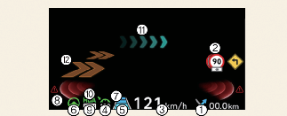

图像：官方在线手册图；OCV 图例；印度官方手册。[原始出处](https://www.kia.com/content/dam/kia2/in/en/content/ev6-manual/topics/chapter5_19_2.html)。

读图：编号 1 是普通 TBT，11 是 AR TBT；Standard 图例 11 改为周围车辆信息。

- **模式与设置：** AR／Standard／Off；AR 校准和内容选择
- **AR 导航：** AR 模式在普通信息外加入 AR TBT、AR 车道安全、前车标记、前车起步、辅助变道；部分项依赖配置。
- **SR／环境：** Standard 图例明确有周围车辆信息；AR 模式主要用对象标记和动态引导，不等于完整 SR 模式。
- **地图：** 所引 HUD 列表未列完整地图模式。
- **TBT：** 两种模式都保留普通 TBT；AR 模式还出现 AR TBT。同叫导航不代表同一个位置或表现。
- **辅助驾驶与告警：** SCC 设定车速／车距、LFA、车道安全、盲区、HDA 等按对应功能状态显示。
- **影像／环境／驻车：** AR 为该手册的初始设置；用户可以手动切 Standard，校准和内容可调。
- **边界与待核：** 未标明精确年款，不能套用全部新 EV6。严苛天气可能影响识别；文档没有“雨天自动改 SR”的规则。

事实依据：[EV6](#来源-ev6)、[EV6-S](#来源-ev6-s)、[EV6-L](#来源-ev6-l)。

### 起亚 EV9

海外品牌｜2026 美国 MV1A 手册／HUD 配置｜固定信息区 HUD

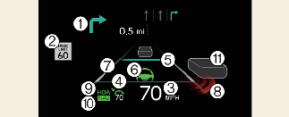

图像：官方手册图；2026 · 美国 MV1A 手册。[原始出处](https://ownersmanual.kia.com/full_webhelp/MV1A/2026/en_US/topics/chapter5_21_1.html)。

读图：上部左侧为逐向箭头和距离

- **模式与设置：** 内容与辅助信息显示；该章未列 AR／Standard 双模式
- **AR 导航：** 本版手册未确认道路 AR 导航；不能由 EV6 有 AR-HUD 推导 EV9 也相同。
- **SR／环境：** 明确列 Surrounding vehicle information，可归 SR 类信息；无独立 SR 模式名称。
- **地图：** 未列二维完整地图模式。
- **TBT：** 确认 TBT（按配置／地区）；道路标志与 TBT 在部分地区提供。
- **辅助驾驶与告警：** SCC 车速／车距、LFA、车道安全、盲区、HDA 和高速自动调速等。
- **影像／环境／驻车：** 围绕行车信息与辅助状态；未确认摄像头视频投到 HUD。
- **边界与待核：** 同品牌不同车型的 HUD 能力不同；EV6 的 AR 图例不可借给 EV9。

事实依据：[EV9](#来源-ev9)。

### 丰田 Camry

海外品牌｜2024 北美 Quick Reference Guide／HUD 配置｜固定信息区 HUD

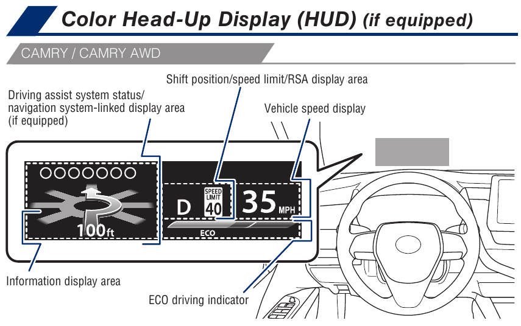

图像：官方快速指南 · 局部；2024 · 北美 HUD 配置。[原始出处](https://assets.sia.toyota.com/publications/en/om-s/OM24K1QRG/pdf/OM24K1QRG.pdf#page=19)。

读图：左侧共享导航与辅助驾驶区域

- **模式与设置：** HUD 开关及亮度／位置等设置
- **AR 导航：** 所引手册未列道路 AR 导航。
- **SR／环境：** 驾驶辅助状态和车道符号不自动等于完整环境重建；本版不计 SR 全景。
- **地图：** 本章未列 HUD 小地图模式。
- **TBT：** 确认 HUD 与导航系统联动（按配置）；这张概览图标出导航联动区，没有展开具体 TBT 图形。
- **辅助驾驶与告警：** 驾驶辅助信息区表达相应系统状态；与基础车速共同构成主要内容。
- **影像／环境／驻车：** 显示信息可按车辆菜单设置；具体多媒体内容依配置。
- **边界与待核：** 北美 2024 是代际锚点，不是对中国新款凯美瑞的完整能力结论。

事实依据：[TOYOTA](#来源-toyota)。

### 本田 Accord Hybrid

海外品牌｜2026 北美 HUD 配置｜固定信息区 HUD

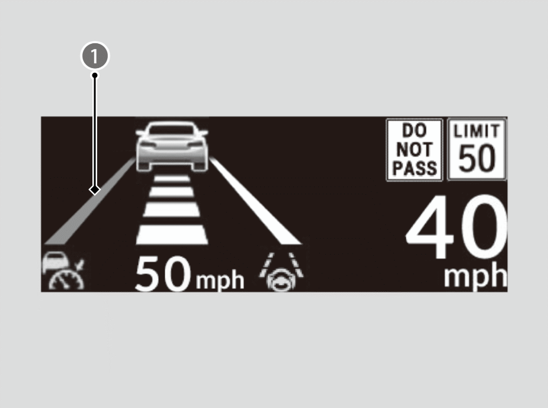

图像：官方手册图；2026 · 北美 HUD 配置。[原始出处](https://techinfo.honda.com/rjanisis/pubs/OM/AH/A30B2626IOM/enu/details/683838e7c795e9-04852150.html)。

读图：手册列出逐向指引，示图为车道告警态

- **模式与设置：** 方向盘选择 HUD 内容；显示项目依版本
- **AR 导航：** 所引手册未列道路注册 AR 导航。
- **SR／环境：** Honda Sensing 状态图为辅助显示；未确认完整 SR 世界重建。
- **地图：** 未确认 HUD 完整小地图。
- **TBT：** 确认转向导航提示；导航来源与连接条件须按手册具体项目核对。
- **辅助驾驶与告警：** Honda Sensing 状态按相应系统工作显示，不能当作车辆自动驾驶许可。
- **影像／环境／驻车：** 电源 ON 时显示；可经驾驶员信息界面选择罗盘、TBT 与辅助系统相关信息。
- **边界与待核：** 只描述 2026 北美 HUD 配置；不直接移用到中国雅阁。

事实依据：[HONDA](#来源-honda)。

### 马自达 CX-90

海外品牌｜2025 美国 Active Driving Display／部分配置｜固定信息区 HUD

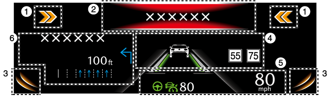

图像：官方在线手册图；2025 美国手册／6 个显示区域。[原始出处](https://www.mazdausa.com/static/manuals/2025/cx-90/contents/65060100.html)。

读图：左侧导航 100 ft，中央车道／前车和巡航，右侧车速；上部和两侧预留告警区。

- **模式与设置：** 独立导航／辅助／警告区域；可调显示信息
- **AR 导航：** 该手册未列道路注册 AR 导航。
- **SR／环境：** i-ACTIVSENSE 区可见车道和前车图形；归局部重建式辅助显示，不宣称完整 SR。
- **地图：** 未列 HUD 小地图模式。
- **TBT：** 导航区显示转向及距离；图中为 100 ft 指令。
- **辅助驾驶与告警：** FCTA 横向穿行警报、BSM 盲区、警告引导和 i-ACTIVSENSE 分区显示。
- **影像／环境／驻车：** 可记忆显示位置、亮度及显示信息；显示设置通过 Mazda Connect。
- **边界与待核：** 固定车道透视图并不构成贴路 AR；内容依配置。

事实依据：[MAZDA](#来源-mazda)。

### 沃尔沃 XC90

海外品牌｜美国当前产品页／2025 手册辅助核对｜固定信息区 HUD

图像缺口：官网原图下载受限。[原始来源入口](https://www.volvocars.com/us/cars/xc90/features/)。

- **模式与设置：** HUD 基本驾驶信息；Calm／Navi 是仪表模式
- **AR 导航：** 所引官方资料未确认道路注册 AR 导航。
- **SR／环境：** 未取得 HUD 完整环境重建模式的证据。
- **地图：** 详细地图的 Navi 视图在 12.3 英寸仪表；不能错误记为 HUD 地图模式。
- **TBT：** HUD 确认导航指令、车速和限速；不用完整地图也能提供下一动作。
- **辅助驾驶与告警：** 警告等可由 HUD 呈现，逐项辅助驾驶图形仍需对应手册。
- **影像／环境／驻车：** 亮度、位置可调；官方将仪表与 HUD 的信息分工分别介绍。
- **边界与待核：** 原图下载受限，保留官方原图入口，不用其他车型照片替代。

事实依据：[VOLVO](#来源-volvo)、[VOLVO-M](#来源-volvo-m)。

### 比亚迪 海豹 SEAL

中国品牌｜欧版左舵／2024-10 手册；非中国新款｜固定信息区 HUD

图像缺口：手册文字证据；HUD 内容图待补。[原始来源入口](https://www.byd.com/content/dam/byd-site/eu/support/service/manual/20250219/BYD%20SEAL%20Owner%27s%20Manual-Left-hand%20Drive-EN-241025.pdf#page=133)。

- **模式与设置：** Classic／Snow；可选安全驾驶辅助信息
- **AR 导航：** 手册 HUD 章未确认贴路 AR 导航。
- **SR／环境：** 车道偏离和 BSD 是状态／预警信息；没有取得完整 SR 重建证据。
- **地图：** 该版 HUD 章未列小地图显示模式。
- **TBT：** 所引欧版 HUD 章列举项未明确导航形式，本版保留未核实；不等于其他市场或 OTA 均无导航。
- **辅助驾驶与告警：** 明确显示车速、限速、ACC、车道偏离和 BSD；安全辅助信息可选，默认开启。
- **影像／环境／驻车：** Classic 默认，Snow 按环境选；亮度、高度、旋转可调并记忆上次状态。
- **边界与待核：** 采用官方手册设置页，不把座舱可旋转中控图当成 HUD 内容证明。

事实依据：[SEAL](#来源-seal)。

### 比亚迪 宋 L DM-i

中国品牌｜2026 中国用户手册／HUD 按配置｜固定信息区 HUD

图像缺口：官方手册设置页；非道路 HUD 画面。[原始来源入口](https://www.byd.com/material/domestic-official/user-manual/dynasty/2026%E6%AC%BE%E5%AE%8BLDM-i%E7%94%A8%E6%88%B7%E6%89%8B%E5%86%8C.pdf)。

- **模式与设置：** HUD 开关；位置、亮度、旋转及模式设置按手册
- **AR 导航：** 所引章节未确认贴路 AR 导航。
- **SR／环境：** 未确认完整 SR 模式；车道偏离／盲区提示不等于全景环境重建。
- **地图：** 确认 HUD 可显示导航，但该章未证明完整小地图模式。
- **TBT：** 确认导航信息进入 HUD；具体 TBT 图形及地图源支持需对应界面补图。
- **辅助驾驶与告警：** 手册列车速、导航、限速、ACC、车道偏离和盲区监测等。
- **影像／环境／驻车：** 中控设置→声音显示开启／关闭 HUD；出厂开启，重新启动车辆记忆上次状态。
- **边界与待核：** 国内大众价位的普通 HUD 样本；不因支持导航就归 AR-HUD。

事实依据：[SONGL](#来源-songl)。

## 各家及国内外差异

### 国内样本的主要扩展：从导航走向辅助驾驶与影像

问界把 AR 指引、意图文字、影像、地图做成多个开关；理想把地图和环境随辅助驾驶状态组合；零跑公开三模式；乐道提供环境感知常驻。

分析：这组样本体现内容整合与场景组合较多。不能据此推导全部中国车型体验都领先。

依据：[M9](#来源-m9)、[M8](#来源-m8)、[LI](#来源-li)、[C11](#来源-c11)、[L60](#来源-l60)。

### 海外内部存在明显分层

奔驰、奥迪、大众拥有道路 AR 或空间导航；宝马采用信息带＋独立 3D HUD；丰田、本田、沃尔沃样本重固定车速、导航、状态。

分析：“海外只有 TBT”不成立；也不能把一款豪华 AR-HUD 的能力代表所有海外车型。

依据：[MB](#来源-mb)、[AUDI](#来源-audi)、[VW](#来源-vw)、[BMW](#来源-bmw)、[TOYOTA](#来源-toyota)、[HONDA](#来源-honda)、[VOLVO](#来源-volvo)。

### SR 的分歧比国别更关键

理想用固定中央环境区；蓝山使用 SR-HUD 名称；EV6/IONIQ 5 的 Standard 图例有周围车辆；深蓝单列场景重建。

分析：SR 是理解系统感知的界面方法，既可能手动常驻，也可能随辅助状态改变。应逐车看开关，不能约定“辅助驾驶时一律用 SR”。

依据：[LI](#来源-li)、[WEY](#来源-wey)、[L60](#来源-l60)、[EV6](#来源-ev6)、[HY](#来源-hy)、[S07](#来源-s07)。

### AR 触发不由“城市 / 高速”两字决定

问界手册的手动 AR 指引与小鹏发布的导航／辅助路径用途不同；EV6 用显示模式；大众强调导航与 ACC/Travel Assist 分工。

分析：“高速 AR、城市 SR、没信号 TBT”不是已证实的通用规则。应记录导航源、软件模式、驾驶状态、对象、开关与地区。

依据：[M9](#来源-m9)、[G7](#来源-g7)、[EV6](#来源-ev6)、[VW-V](#来源-vw-v)。

### 地图生态与投屏支持也是差距

问界样本仅支持系统自带地图；ID.7 Tourer 的对应更新明确接入 CarPlay／Android Auto 的活动导航。

分析：地图能在中控运行，不代表它能输出 HUD TBT，更不代表能输出道路 AR；必须分三层核验。

依据：[M9](#来源-m9)、[M8](#来源-m8)、[VW](#来源-vw)。

### 海外也在扩展舒适内容

Q6 官方技术说明有音乐曲名和语音头像；VISTIQ 手册有来电；蓝山则有明确歌词设置。

分析：是否整合舒适内容与品牌策略、眼前区域和任务有关，不能简化为国内丰富、国外保守。

依据：[AUDI](#来源-audi)、[GM](#来源-gm)、[WEY](#来源-wey)。

### 硬件大、模式多，并不是体验结论

当前证据主要是手册、官方技术图和少量媒体实拍；没有统一驾驶位置、相机曝光、道路环境和软件版本的横向实测。

分析：本研究比较能力与逻辑，不给真实亮度、眩晕、AR 注册误差或安全收益排总榜。

依据：。

## 体验差距与下一轮验证

### 空间注册

问题：箭头／目标是否随实际道路、坡道、头部移动稳定落在正确位置？

所需证据：同一路口与不同坐姿的连续视频、对齐误差和延迟实测。

当前结论：现有静态图不能给中国／海外的数值排名。

### 理解辅助驾驶

问题：能否分清可用、激活、待执行、执行、接管，以及系统准备变道的方向？

所需证据：同一套人工驾驶→ACC→领航→接管→退出任务记录。

当前结论：理想自动加入环境、深蓝目标触发、大众系统分工已有文档依据。

### 导航链路

问题：同一导航源能否输出 TBT、地图与道路 AR？何时路口放大？

所需证据：车机内置与 CarPlay／Android Auto 分开，逐应用／地区核验。

当前结论：问界限制与大众 Tourer 更新构成直接差异；不能推广为整个国内外生态。

### 模式覆盖

问题：简洁模式是否仍保留告警？SR 是否常驻？倒车时哪些内容退出？

所需证据：逐状态录屏＋开关表，包含导航与辅助同时激活。

当前结论：理想车速模式被辅助驾驶补充、问界极简禁影像，说明模式优先级存在品牌差异。

### 可读性与遮挡

问题：白天是否可读，夜间是否过亮；视频与重建是否占用目标视野？

所需证据：同硬件测量和用户任务；偏光镜、眼盒边缘、雨夜分别记录。

当前结论：本页不按照片颜色、尺寸或亮度外观判胜负。

### 版本与交付

问题：某功能是发布演示、可选硬件、当前 OTA、还是后续规划？

所需证据：VIN 对应配置、车机版本、发行记录、当地手册。

当前结论：小鹏发布演示、SU7 OTA 线索、IONIQ 5 旧版手册均单列边界。

## 资料与图源

### 来源 M9

[问界 M9 2026 款增程版使用说明书](https://hima.auto/dam/hima-site/cn/wenjie/service/pdf/260930/问界M92026款增程版使用说明书.pdf)

官方手册｜中国；260930 目录版；使用既有原始 PDF 归档核验

定位：PDF／标页 28–30；AR 车道指引、显示模式、影像、小地图、意图文字

状态：已核验正文；查阅 2026-11-23。

### 来源 M8

[问界 M8 增程版使用说明书](https://hima.auto/dam/hima-site/cn/wenjie/service/pdf/260930/问界M8增程版使用说明书.pdf#page=28)

官方手册｜中国；260930 目录版；使用既有原始 PDF 归档核验

定位：PDF／标页 28–31；尤其第 30 页 AR 车道指引、第 31 页 P 挡观影限制

状态：已核验正文；查阅 2026-11-23。

### 来源 LI

[理想 i8 抬头显示装置界面总览](https://manuals.lixiang.com/zh-cn/W022026MAX/20260805185610/topic-2025-B9EDF622.html)

官方手册｜i8 2026 Max；20260805185610 在线手册

定位：界面模式、地图显示模式、路口放大图、路口红绿灯、数字后视镜影像

状态：已核验正文；查阅 2026-11-23。

### 来源 G7

[小鹏与华为联合发布追光全景 AR-HUD](https://www.xiaopeng.com/news/company_news/5473.html)

官方发布演示｜2025-06-05；发布场景不等于每个软件版本均已交付

定位：三大创新场景；导航／辅助驾驶／安全

状态：已核验正文；查阅 2026-11-23。

### 来源 C11

[全新 C11 AR-HUD 联合技术发布](https://ams-osram.com/de/news/media-stories/ar-hud)

供应商联合发布｜2025-11-25；2026 款全新 C11

定位：多模式精准交互；车速／AR／地图模式；盲区与倒车影像

状态：已核验正文；查阅 2026-11-23。

### 来源 C11-F

[零跑 2025 中期业绩公告](https://www1.hkexnews.hk/listedco/listconews/sehk/2025/0818/2025081801030_c.pdf)

整车企业正式披露｜2025-08-18

定位：正文检索 AR-HUD：首次应用全新 C11 与三种模式

状态：已核验正文；查阅 2026-11-23。

### 来源 C11-I

[全新 C11 转载 HUD 场景画面](https://k.sina.cn/article_7857141524_1d452771401902xlfs.html)

媒体转载画面，仅作图像证据｜2026-06-01 文章；原始拍摄者及软件版本未标明，不能称为本项目独立实测

定位：地图与道路提示画面；仅作图片观察，不采纳其技术排名

状态：已核验正文；查阅 2026-11-23。

### 来源 WEY

[魏牌全新蓝山使用说明书](https://res.gwm.com.cn/2025/10/16/1850405_244_ac7234c7672bb89de159e0e77b997df9_%E9%AD%8F%E7%89%8C%E5%85%A8%E6%96%B0%E8%93%9D%E5%B1%B1-%E4%BD%BF%E7%94%A8%E8%AF%B4%E6%98%8E%E4%B9%A6.pdf)

官方手册｜中国；2025-10-16 文件

定位：PDF／标页 118：SR-HUD 设置、地图、路口放大、增强与歌词

状态：已核验正文；查阅 2026-11-23。

### 来源 WEY-C

[蓝山 SR-HUD 配置名称](https://www.wey.com/lanshan-newConfiguration.html)

官方配置页｜历史全新蓝山配置；不套用二代蓝山

定位：29 英寸 SR-HUD 模拟现实抬头显示

状态：已核验正文；查阅 2026-11-23。

### 来源 L60

[乐道 L60 用户手册](https://cdn-up-public.onvo.cn/www-alps-cn/user-instructions/L60-User-Manual-20251028.pdf)

官方手册｜中国；2025-10-28 文件

定位：PDF 第 100–101 页／标页 99–100：抬头显示、环境感知常驻显示、雪地模式

状态：已核验正文；查阅 2026-11-23。

### 来源 NIO

[ET7 Enhanced Head-Up Display System](https://www.nio.com/cdn-static/www/user-instructions/en_EU/ET7/index.html)

官方手册｜欧版英文在线手册；正文通过网页检索核验，直接下载受限

定位：Driving and Parking → Feature Settings → Enhanced Head-Up Display；ESD 单列章节

状态：已核验正文；查阅 2026-11-23。

### 来源 NIO-P

[ET7 产品页：16.3 英寸增强 HUD](https://www.nio.com/et7)

官方产品页｜2026-11-23 检索；图片资产目录 2026-04-13

定位：Digital cockpit → Enhanced 16.3-Inch Head-Up Display；导航及路口放大图

状态：已核验正文；查阅 2026-11-23。

### 来源 ZEEKR

[极氪 007 全球产品页](https://www.zeekrlife.com/global/vehicles/007)

官方产品图｜全球展示页，首发代外观／座舱；不代表全部地区软件

定位：Intelligent Cockpit → 35.5-inch AR-HUD；配图的导航及车道车辆

状态：已核验正文；查阅 2026-11-23。

### 来源 SU7-P

[小米汽车配置表](https://www.xiaomiev.com/xiaomi/car-config)

官方配置页｜动态页面，2026-11-23 检索；年款须逐车确认

定位：HUD 与 SR 路面感知系统分别列项；不能由整车配置推出 HUD 内功能

状态：已核验正文；查阅 2026-11-23。

### 来源 SU7-I

[小米 SU7 媒体实车画面](https://www.electrive.com/2024/05/07/first-drive-xiaomi-su7-tracing-the-rise-of-xiaomi/)

媒体实拍，仅作图像证据｜2024-05-07；初代 SU7 图片

定位：HUD 实拍：车速、小地图、转向距离

状态：已核验正文；查阅 2026-11-23。

### 来源 SU7-LEAD

[SU7 HUD OTA 更新线索](https://www.cqn.com.cn/auto/content/2026-03/24/content_9149660.htm)

媒体线索，未纳入确认矩阵｜报道的卡片、HAD 轨迹与影像需官方 OTA 日志或对应实车版本复核

定位：2026-03-24 报道；仅作为继续寻找官方版本说明的线索

状态：二手线索，未升级为技术事实；查阅 2026-11-23。

### 来源 YU7

[小米 YU7 产品页](https://www.xiaomiev.com/yu7)

官方产品图｜2025 首发图；作为 PHUD 架构对照

定位：天际屏全景显示／风挡下缘黑区信息带与可编辑内容

状态：已核验正文；查阅 2026-11-23。

### 来源 S07

[DEEPAL S07 Owner’s Manual](https://www.deepal.com.au/media/lemnpbqs/deepal_s07_owners_manual_211125.pdf#page=134)

官方手册｜澳大利亚；文件 211125；不外推中国版本

定位：PDF 134–135／标页 122–123：11 项图例、行车信息及 Standard/Snow

状态：已核验正文；查阅 2026-11-23。

### 来源 MB

[S-Class W223 Digital My MBUX](https://media.mbusa.com/news/meet-the-s-class-digital-my-mbux-mercedes-benz-user-experience)

官方技术发布｜2020 代际发布；配可选 AR-HUD

定位：AR-HUD 的导航、车距和驾驶辅助投影

状态：已核验正文；查阅 2026-11-23。

### 来源 MB-26

[2026 S-Class 技术发布：Surround Navigation 与 AR-HUD](https://media.mercedes-benz.com/en/press-kit/71dc2a9c-34c7-47e0-a264-d39d89b85d4c/article/8e671658-cf56-45c3-8ba7-15e997dee179)

官方技术发布｜改款发布；与 2020 配图分开记录

定位：Navigate with confidence：3D 周围环境在 driver’s display；AR 引导在 HUD

状态：已核验正文；查阅 2026-11-23。

### 来源 AUDI

[Audi Q6 e-tron 新显示与操作概念](https://www.audi.com/en/the-audi-q6-e-tron-electric-mobility-on-a-new-level-15929/experience-digitalization-new-display-and-operating-concept-15941)

官方技术说明｜2024-06-28；德国规格

定位：第二代 AR-HUD、斜像面、导航／辅助／音乐／语音头像

状态：已核验正文；查阅 2026-11-23。

### 来源 AUDI-I

[Audi Q6 e-tron 官方 AR-HUD 技术图](https://www.audi-technology-portal.de/en/electrics-electronics/controls/audi-q6-e-tron-new-display-operating-concept-en)

官方技术图｜2024 技术图

定位：状态区与道路关联显示区

状态：已核验正文；查阅 2026-11-23。

### 来源 VW

[ID.7 Tourer 座舱与 AR-HUD 更新](https://www.volkswagen-newsroom.com/en/the-new-id7-tourer-the-world-premiere-18150/passenger-compartment-cockpit-and-comfort-redefined-18155)

官方技术发布｜2024-02-19 欧洲 ID.7 Tourer 首发，不外推全部 ID.7 软件

定位：Enhanced augmented reality head-up display；手机导航接入 AR 路线

状态：已核验正文；查阅 2026-11-23。

### 来源 VW-V

[ID.7 / ID.7 Tourer 官方操作视频](https://www.youtube.com/watch?v=mDXF2zydjtI)

官方操作视频｜Volkswagen Österreich；2025-10-17

定位：官方说明：ACC 车距、Travel Assist 车道、View 切换近区

状态：已核验正文；查阅 2026-11-23。

### 来源 BMW

[BMW iX3：Panoramic iDrive 与 3D HUD](https://www.press.bmwgroup.com/usa/article/detail/T0452316EN_US/the-all-new-bmw-ix3?forceSitePreference=DESKTOP)

官方车型发布｜2025-09 发布；新世代 iX3，非旧款 G08

定位：数字座舱／选装 3D Head-Up Display 的导航与自动驾驶图形

状态：已核验正文；查阅 2026-11-23。

### 来源 BMW-I

[BMW Panoramic iDrive 四个交互单元](https://www.bmwgroup.com/en/news/general/2025/newidrive.html)

官方技术图｜2025-01-07 技术发布图，不作在售配置证明

定位：Panoramic Vision 与选装 3D HUD 分开

状态：已核验正文；查阅 2026-11-23。

### 来源 GM

[Cadillac VISTIQ Owner Manual 2026](https://www.cadillaceurope.com/content/dam/cadillac/eu/europe/lyriq/owner-manuals/2026/26_CAD_VISTIQ_OM_en_GB_E_DVS2026EN_2025JUN26_HI.pdf)

官方手册｜欧洲英文，2025-06-26 文件；实拍来自北美，具体设置以本市场为准

定位：PDF 115–117：近／远层；Standard、Augmented Reality、Assist 三视图

状态：已核验正文；查阅 2026-11-23。

### 来源 GM-I

[VISTIQ 北美媒体试驾 HUD 画面](https://www.tomsguide.com/vehicle-tech/evs/i-drove-the-2026-cadillac-vistiq-for-a-week-and-its-just-the-right-mix-of-luxury-and-value)

媒体实拍，仅作图像证据｜2026 Platinum；2025-10-12

定位：AR HUD 实拍，原文转弯场景

状态：已核验正文；查阅 2026-11-23。

### 来源 HY

[IONIQ 5 2022 Convenience Features](https://manuals.hyundai.co.uk/umanuals/ioniq-5/ioniq-5-2022-convenience-features.pdf)

官方手册｜英国 2022 手册；不外推 2025 改款及所有市场

定位：PDF 58–60／标页 5-58–5-60：AR/Standard、编号图例、校准

状态：已核验正文；查阅 2026-11-23。

### 来源 EV6

[EV6 Head-up display information](https://www.kia.com/content/dam/kia2/in/en/content/ev6-manual/topics/chapter5_19_2.html)

官方手册｜印度官方英文在线手册；代际版面 OCV，未标精确年款

定位：AR 图例 1–15、Standard 图例 1–11

状态：已核验正文；查阅 2026-11-23。

### 来源 EV6-S

[EV6 Head-up display settings](https://www.kia.com/content/dam/kia2/in/en/content/ev6-manual/topics/chapter5_19_1.html)

官方手册｜同上

定位：Display mode → Augmented reality / Standard；AR calibration

状态：已核验正文；查阅 2026-11-23。

### 来源 EV6-L

[EV6 HUD 使用边界](https://www.kia.com/content/dam/kia2/in/en/content/ev6-manual/topics/chapter5_19_3.html)

官方手册｜同上

定位：默认 AR；天气／温度限制与设置变化

状态：已核验正文；查阅 2026-11-23。

### 来源 EV9

[EV9 Head Up Display Information](https://ownersmanual.kia.com/full_webhelp/MV1A/2026/en_US/topics/chapter5_21_1.html)

官方手册｜美国 MV1A／2026 在线手册

定位：图例 1–11；TBT、SCC、LFA、HDA、周围车辆

状态：已核验正文；查阅 2026-11-23。

### 来源 TOYOTA

[Camry 2024 Quick Reference Guide](https://assets.sia.toyota.com/publications/en/om-s/OM24K1QRG/pdf/OM24K1QRG.pdf#page=19)

官方手册｜北美 2024 HUD 配置；既有 PDF 归档

定位：PDF 19／标页 17：HUD 信息与设置

状态：已核验正文；查阅 2026-11-23。

### 来源 HONDA

[Accord Hybrid 2026 Head-Up Display](https://techinfo.honda.com/rjanisis/pubs/OM/AH/A30B2626IOM/enu/details/683838e7c795e9-04852150.html)

官方手册｜北美 2026 HUD 配置；既有 HTML 归档

定位：About the Head-Up Display：ACC／LKAS／Traffic Jam Assist、罗盘／TBT、LDW／BRAKE／交通标志

状态：已核验正文；查阅 2026-11-23。

### 来源 MAZDA

[CX-90 Active Driving Display](https://www.mazdausa.com/static/manuals/2025/cx-90/contents/65060100.html)

官方手册｜美国 2025／Some Models

定位：6 个显示区域：FCTA、警告、BSM、i-ACTIVSENSE、车速、导航

状态：已核验正文；查阅 2026-11-23。

### 来源 VOLVO

[XC90 Displays and connectivity](https://www.volvocars.com/us/cars/xc90/features/)

官方产品页｜当前美国页面，2026-11-23 检索；图片下载 403

定位：仪表 Calm/Navi 视图；HUD 的车速、限速、导航

状态：已核验正文；查阅 2026-11-23。

### 来源 VOLVO-M

[XC90 2025 User Manual](https://www.volvocars.com/static/support-content/pdfs/ca_en-US_xc90_2025_UM_6e3b26cb01c1e1af2865833875bdda3b.pdf)

官方手册｜2025 24w17；网页检索可读，本地下载 403

定位：4.3.1–4.3.2 HUD 及显示设置

状态：检索正文已核验；未取得本地 PDF；查阅 2026-11-23。

### 来源 WEY-I

[蓝山智驾版媒体静态体验图](https://m.youcheyihou.com/news/1448654)

媒体实拍，仅作图像证据｜2024-04 发布前演示；不证明 2025 歌词功能

定位：HUD 特写，文章明确为静态演示状态

状态：已核验正文；查阅 2026-11-23。

### 来源 SEAL

[BYD SEAL 欧版左舵用户手册](https://www.byd.com/content/dam/byd-site/eu/support/service/manual/20250219/BYD%20SEAL%20Owner%27s%20Manual-Left-hand%20Drive-EN-241025.pdf)

官方手册｜2024-10-25 手册；2025-02 官网页径；仅此欧版

定位：标页 133：HUD、Classic／Snow、可选辅助信息

状态：已核验正文；查阅 2026-11-23。

### 来源 SONGL

[2026 款宋 L DM-i 用户手册](https://www.byd.com/material/domestic-official/user-manual/dynasty/2026%E6%AC%BE%E5%AE%8BLDM-i%E7%94%A8%E6%88%B7%E6%89%8B%E5%86%8C.pdf)

官方手册｜中国 2026 款；HUD 随配置

定位：4-5 驾驶辅助功能／标页 281–282：HUD 导航及显示设置

状态：已核验正文；查阅 2026-11-23。

## 使用边界

图片保持原内容，仅作研究引用；未加绘 HUD。媒体照片只确认画面可见内容，不证明动态触发。资料年代不一，不构成统一 2026 在售配置排名。未实测注册误差、延迟、亮度、安全收益，不按照片曝光或等效英寸判胜负。图片版权归原出版方。
